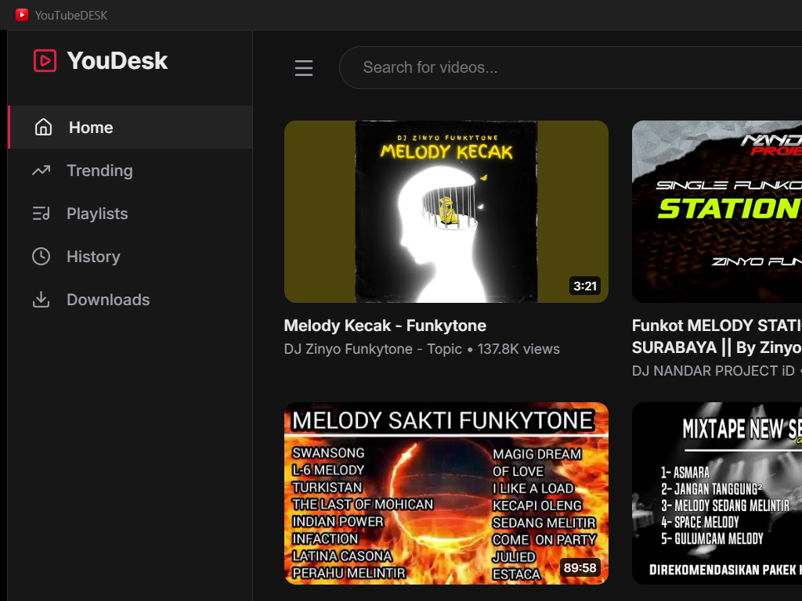
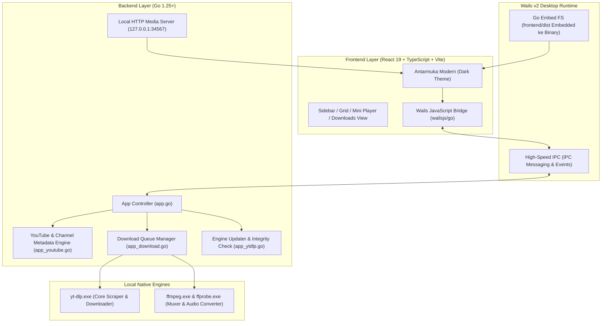

<p align="center">
  
</p>

<h1 align="center">YouDesk</h1>

<p align="center">
  <strong>Modern, Ultra-Fast & Resource-Friendly YouTube Desktop Client</strong><br>
  Built with Go, Wails v2, React 19, TypeScript, and powered by yt-dlp.
</p>

<p align="center">
  <a href="https://github.com/kyy-95631488/YouDesk/releases"></a>
  <a href="#"></a>
  <a href="https://golang.org"></a>
  <a href="https://wails.io"></a>
  <a href="https://react.dev"></a>
  <a href="https://vitejs.dev"></a>
  <a href="LICENSE"></a>
</p>

---

## 📸 Preview Aplikasi

<p align="center">
  
</p>

---

## ✨ Fitur Unggulan

- ⚡ **Ringan & Cepat (Zero Chromium Bloat)**: Memanfaatkan WebView2 native Windows dengan backend Go yang hemat memori (RAM hanya ~80-150MB dibandingkan browser biasa yang memakan >800MB).
- 🎬 **Browsing & Pencarian Lengkap**: Jelajahi video Beranda, Trending, Channel, Playlist YouTube, dan pencarian instan tanpa login akun.
- 📥 **Media Downloader Terintegrasi**: Unduh video dengan opsi resolusi (1080p, 720p, 480p, dll.) atau format audio murni (MP3 kualitas tinggi) menggunakan engine `yt-dlp` dan `FFmpeg`.
- 🎵 **Floating Audio / Mini Player**: Pemutar musik MP3 internal dengan visual progress bar, shuffle, repeat, draggable floating mini-player, dan playlist queue.
- 🍪 **Dukungan Cookies Browser**: Ambil cookies dari browser utama (Chrome, Edge, Firefox, Brave) untuk melewati batasan usia atau verifikasi bot YouTube.
- 📺 **Watch History & Progress Resume**: Melacak riwayat tontonan dan otomatis melanjutkan video dari detik terakhir diputar.
- 📦 **Tersedia Versi Installer & Portable**: Pilihan installer resmi (Inno Setup) dengan desktop shortcut atau paket portable plug-and-play untuk flashdisk.

---

## 📥 Pilihan Unduhan & Distribusi

Anda dapat memilih dua tipe paket instalasi sesuai kebutuhan di [**GitHub Releases**](https://github.com/kyy-95631488/YouDesk/releases):

| Tipe Paket | File Output | Target Penggunaan |
| :--- | :--- | :--- |
| **Standalone Installer** | `YouTubeDESK-Installer-v1.0.0.exe` | **Direkomendasikan untuk PC/Laptop utama**. Installer resmi berbasis Inno Setup 6, membuat Start Menu & Desktop Shortcut, otomatis include engine offline, dan memiliki uninstaller resmi di Windows Settings. |
| **Portable Edition (ZIP)** | `YouTubeDESK-Portable.zip` | **Plug & Play / Flashdisk**. Cukup ekstrak ZIP ke folder mana saja dan langsung jalankan `YouTubeDESK.exe` tanpa proses instalasi apa pun. Semua komponen offline sudah include. |

---

## 🏗️ Arsitektur Sistem

YouDesk dirancang dengan arsitektur hybrid modern yang memisahkan tampilan interaktif dengan logika pemrosesan media berkinerja tinggi:



---

## 🛠️ Tech Stack & Dependencies

### Frontend
- **Framework**: [React 19](https://react.dev/) + [TypeScript 5.6](https://www.typescriptlang.org/)
- **Bundler & Dev Server**: [Vite 7](https://vitejs.dev/)
- **Icons**: [Lucide React](https://lucide.dev/)
- **Player Wrapper**: [react-youtube](https://github.com/tjallingt/react-youtube)
- **Styling**: Vanilla CSS kustom dengan Glassmorphic & Modern Dark Theme tokens

### Backend & Desktop Wrapper
- **Language**: [Go (Golang) 1.25+](https://golang.org/)
- **Desktop Framework**: [Wails v2.16](https://wails.io/) (Menggunakan Windows WebView2 native)
- **Asset Strategy**: `//go:embed all:frontend/dist` (UI menyatu di dalam binary tunggal)
- **Local Streaming**: Built-in HTTP Range Server untuk streaming audio/video bebas CORS

### Media & Download Engines
- **Core Downloader**: [yt-dlp](https://github.com/yt-dlp/yt-dlp)
- **Media Transcoder**: [FFmpeg & FFprobe](https://ffmpeg.org/) (Static build)

### Packaging & Distribution
- **Windows Installer**: [Inno Setup 6](https://jrsoftware.org/isinfo.php) (Kompresi LZMA2/Ultra64)
- **Automation**: PowerShell 7+ & GitHub Actions CI/CD

---

## 💻 Panduan Pengembang (Development Guide)

Jika Anda ingin berkontribusi atau mengembangkan YouDesk sendiri di komputer lokal:

### 1. Prasyarat Sistem
Pastikan tool berikut sudah terpasang di komputer Anda:
- [Go (v1.23 atau lebih baru)](https://go.dev/dl/)
- [Node.js (v18 atau lebih baru)](https://nodejs.org/) & `npm`
- [Wails CLI v2](https://wails.io/docs/gettingstarted/installation):
  ```bash
  go install github.com/wailsapp/wails/v2/cmd/wails@latest
  ```
- *(Opsional untuk build installer)* [Inno Setup 6](https://jrsoftware.org/isdl.php)

### 2. Kloning & Instalasi
```bash
# Clone repository
git clone https://github.com/kyy-95631488/YouDesk.git
cd YouDesk

# Install dependensi frontend
cd frontend
npm install
cd ..
```

### 3. Menjalankan Mode Live Development
Jalankan perintah berikut di root folder project:
```bash
wails dev
```
Perintah ini akan menyalakan Vite development server dengan fitur Hot Module Replacement (HMR) dan membuka jendela aplikasi desktop secara langsung.

---

## 🔨 Membangun File Rilis (Build & Packaging)

YouDesk menyediakan skrip build interaktif yang sangat mudah digunakan di Windows:

### Menggunakan Menu Interaktif:
Cukup klik dua kali file **`build.bat`** atau jalankan lewat terminal:
```cmd
build.bat
```
Akan muncul menu:
```text
=========================================================
      YOUTUBE DESKTOP - SISTEM BUILD OTOMATIS
=========================================================
  [1] Build Versi STANDALONE INSTALLER (Inno Setup Compiler)
  [2] Build Versi PORTABLE (Full Offline Bundle ZIP & Folder)
  [3] Build KEDUANYA (Standalone Installer + Portable ZIP)
  [4] Build untuk Linux (Docker)
  [5] Bersihkan Hasil Build (Clean dist & cache)
  [6] Keluar
=========================================================
```

### Menggunakan PowerShell Langsung:
```powershell
# Build Standalone Installer saja:
powershell -ExecutionPolicy Bypass -File .\build_packages.ps1 -Target standalone

# Build Portable ZIP saja:
powershell -ExecutionPolicy Bypass -File .\build_packages.ps1 -Target portable

# Build Semua Varian sekaligus:
powershell -ExecutionPolicy Bypass -File .\build_packages.ps1 -Target all
```
Semua file hasil build akan tersimpan rapi di direktori `dist/`.

---

## 🤖 Otomatisasi GitHub Actions CI/CD

Repository ini dilengkapi pipeline otomatisasi pada file [`.github/workflows/release.yml`](.github/workflows/release.yml):

1. **Auto Tagging**: Setiap kali Anda melakukan push ke branch `main`, GitHub Actions secara cerdas membaca tag terakhir dan otomatis membuat tag versi baru (misal `v1.0.1`).
2. **Auto Metadata Repository**: Otomatis mengisi deskripsi repo, homepage, serta topik/tag (seperti `youtube`, `desktop-app`, `wails`, `golang`, `react`, `yt-dlp`).
3. **Auto Compile & Release**: Mengompilasi kode di lingkungan Windows Server, mengunduh engine ffmpeg/yt-dlp, membangun installer Inno Setup, mengompres paket Portable ZIP, dan mempublikasikannya langsung ke halaman GitHub Releases.

---

## 📁 Struktur Direktori Project

```text
YouDesk/
├── .github/
│   └── workflows/
│       └── release.yml        # Pipeline CI/CD Auto-Release & Tagging
├── build/
│   ├── appicon.png            # Icon aplikasi resolusi tinggi
│   ├── bin/                   # Output binary Wails & dependency cache
│   └── windows/               # Manifest, resource info, & icon.ico
├── docs/
│   └── assets/                # Aset dokumentasi, logo, dan preview screenshot
├── frontend/
│   ├── src/
│   │   ├── components/        # Komponen React (Sidebar, Player, dll.)
│   │   ├── views/             # Tampilan halaman (Home, DownloadsView, dll.)
│   │   ├── App.tsx            # State utama & routing antarmuka
│   │   └── App.css            # Desain sistem & styling kustom
│   ├── package.json           # Dependensi React, Vite, Lucide
│   └── vite.config.ts         # Konfigurasi bundler Vite
├── dist/                      # Folder output build (Standalone & Portable)
├── app.go                     # Inisialisasi aplikasi Wails & local streaming
├── app_download.go            # Logika download media & parsing progress
├── app_youtube.go             # Scraper metadata, video, playlist, dan channel
├── app_ytdlp.go               # Manajemen engine yt-dlp & FFmpeg
├── main.go                    # Entry point program Go & AssetServer embedding
├── installer.iss              # Naskah konfigurasi Inno Setup Compiler 6
├── build_packages.ps1         # Skrip otomatisasi packaging PowerShell
├── build.bat                  # Menu interaktif build Windows
└── README.md                  # Dokumentasi resmi aplikasi
```

---

## 📄 Lisensi

Didistribusikan di bawah lisensi **MIT**. Lihat [`LICENSE`](LICENSE) untuk informasi lebih lanjut.

---

<p align="center">
  Dibuat dengan ❤️ oleh <a href="https://github.com/kyy-95631488">kyy-95631488</a>
</p>
